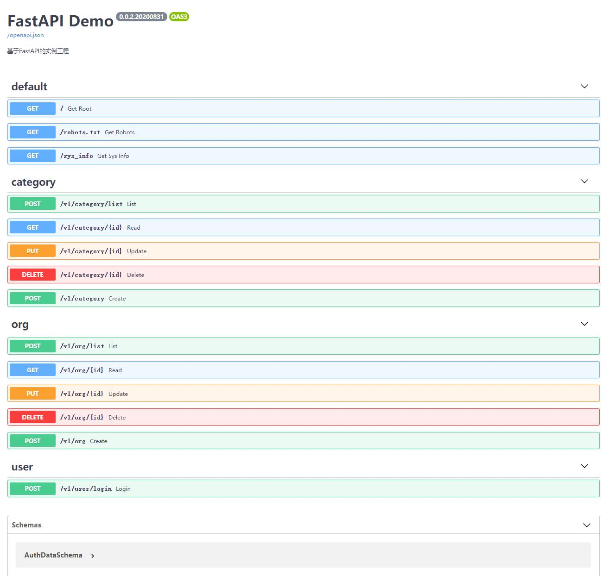

# FastAPI Demo
This is a Python FastAPI example project.

[Github: FastAPI Demo](https://github.com/zhenqiang-sun/fastapi_demo/)

https://github.com/zhenqiang-sun/fastapi_demo/
https://gitee.com/erlitech/fastapi_demo/

## Environment Components

### Version:
Python 3.8

### Components:
- FastAPI Plus: https://github.com/zhenqiang-sun/fastapi_plus/  https://gitee.com/erlitech/fastapi_plus/
- FastAPI: https://fastapi.tiangolo.com/
- uvicorn: https://www.uvicorn.org/
- SQLAlchemy: https://www.sqlalchemy.org/
- PyMySQL: https://pymysql.readthedocs.io/
- REDIS: https://github.com/andymccurdy/redis-py


## Project Structure

```
├─app    # Project source code directory
│  ├─config      # Configuration files directory
│  │  ├─anonymous.py  # Config for interfaces allowing anonymous access
│  │  ├─db.py         # Database connection config, relational DBs like MySQL
│  │  ├─fastapi.py    # FastAPI project config
│  │  ├─mongo.py      # MongoDB connection config
│  │  └─redis.py      # Redis connection config
│  ├─controller  # Controller layer, API entry points
│  ├─dao         # DAO layer, Data Access Objects
│  ├─model       # Model layer, database table objects
│  ├─schema      # Schema layer, data structure validation for API input/output parameter validation, filtering, and conversion
│  ├─service     # Service layer, business logic processing
│  ├─sql         # Raw SQL files directory, complex SQL statements stored here separately
│  ├─templates   # Templates directory, e.g., HTML, Excel, email templates
│  ├─temporary   # Temporary files directory, stores files generated during runtime
│  └─utils       # Utilities
├─docker  # Docker deployment scripts directory
│  ├─deploy.sh   # Shell deployment script
│  ├─deocker-compose.yml  # Docker Compose deployment script
│  └─run.sh      # Script to run the project inside Docker, using uvicorn
├─res     # Project static assets directory, e.g., attachments, images, videos
├─venv    # Python virtual environment directory
├─dev_run.py          # Run project in development mode
└─dev_db_2_model.py   # Generate ORM model.py from existing database tables
├─dev_model_2_db.py   # Generate database tables from existing ORM model.py
└─dev_generate_model.py   # Generate new modules based on Demo code to skip copy-pasting
```


## Development & Running

```bash
# Initialize venv:
virtualenv venv

# If virtualenv is not found, run first:
sudo pip install -i https://mirrors.aliyun.com/pypi/simple/ virtualenv

# Activate venv for Linux/Mac:
source venv/bin/activate

# Activate venv for Windows
venv\Scripts\activate.bat

# Install dependencies:
pip install -i https://mirrors.aliyun.com/pypi/simple/ -r requirements.txt

# Run in development mode
python dev_run.py

# Generate ORM model.py from existing database tables
python dev_db_2_model.py

# Generate database tables from existing ORM model.py
python dev_model_2_db.py

# Generate new modules based on Demo code to skip copy-pasting
python dev_generate_model.py 
```


## API Style
Follows RESTful conventions, with a few specific adaptations.

### Specific API Style Conventions

- 1. Version prefix is placed at the beginning, e.g., `/v1/**`.
- 2. Use POST for fetching lists, as it allows easier transmission of filtering and search parameters.
- 3. Use singular nouns for resource names. This is partly due to the above point, and mainly because except for lists, operations typically target single entities.
- 4. Based on the above two points, list endpoints typically append `/list` to the noun, e.g., `/v1/category/list`.

### API Style Examples

|  Request Method  |  Path  |  Description  |
|  ----  |  ----  |  ----  |
| `POST`    | /v1/category      | Create a category |
| `DELETE`  | /v1/category/{id} | Delete a category |
| `PUT`     | /v1/category/{id} | Update a category |
| `GET`     | /v1/category/{id} | Retrieve a category |
| `POST`    | /v1/category/list | Fetch category list |


## API Examples


